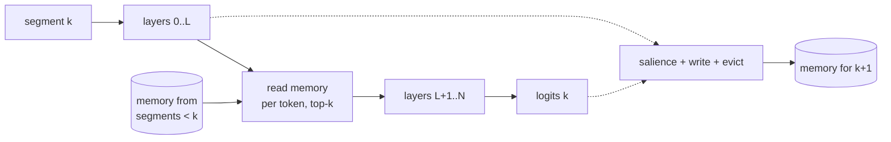

# EngramLM

**Causal, salience-gated external memory for Hugging Face causal language models.**

[](https://github.com/Sanika0212/EngramLM/actions/workflows/ci.yml)


EngramLM wraps any causal LM (Llama, Qwen, Gemma, SmolLM, GPT-2, …) with a memory
that carries information across segments of a long document. After each segment
it decides which tokens matter (salience), writes them into a fixed-size bank,
evicts what has gone stale, and lets later segments read from it, one token at a
time. It is **causal by construction**, starts out **identical to the base model**,
and ships a **numerical audit** that proves both properties instead of assuming
them.

## Why

Memory modules for LMs are easy to get subtly wrong. If anything in the memory
path pools over the current sequence, predictions can see future tokens and
perplexity drops for the wrong reason. EngramLM is built so that this cannot
happen. Memory read in segment *k* only ever contains writes from segments
before *k*, and `engramlm audit` checks it numerically on any model.

## Features

1. **Per-token, past-only reads** at a configurable decoder layer, via a forward
   hook. Works with any Hugging Face causal LM, with no model surgery.
2. **Explicit `MemoryState`** per stream. Evaluation is deterministic and batches
   never share memory.
3. **Vectorized writes and eviction**: `priority` (decayed) or `fifo`, with no
   Python loops over tokens.
4. **Pluggable salience**:
   1. `surprise`: the model's own token NLL.
   2. `learned`: a small MLP trained through later reads, initialised to equal `surprise`.
   3. `random` and `recency` controls.
5. **Sleep-phase consolidation**: merges near-duplicate memories at a fixed budget
   and conserves total priority mass.
6. **Identity at initialisation**: an untrained wrapper reproduces the base model's
   logits bit-for-bit.
7. **Causality audit** (`engramlm audit`): perturbs future tokens and checks that
   earlier logits do not move.
8. **Memory inspector**: a self-contained HTML trace of salience, writes and the
   provenance of every read.
9. **Fair evaluation**:
   1. bits per byte;
   2. identical target sets across variants;
   3. a LoRA-only control;
   4. a full-context reference;
   5. bootstrap intervals.
10. **Training** with truncated backprop through memory, LoRA via PEFT, and
    adapter-only checkpoints.

## Install

```bash
git clone https://github.com/Sanika0212/EngramLM.git
cd EngramLM
uv sync --extra train        # or: pip install -e ".[train]"
```

Requires Python 3.11+. Core dependencies: PyTorch, Transformers, safetensors,
NumPy, PyYAML. The `train` extra adds PEFT and Datasets.

## Quickstart

```python
import torch
from transformers import AutoTokenizer

from engramlm.config import EngramConfig
from engramlm.generation import generate
from engramlm.model import EngramLM
from engramlm.segment import evaluate_document

name = "HuggingFaceTB/SmolLM2-135M"
tokenizer = AutoTokenizer.from_pretrained(name)
model = EngramLM(EngramConfig(base_model_name=name, capacity=256, writes_per_segment=32)).eval()

ids = tokenizer(open("long_document.txt").read(), return_tensors="pt").input_ids
result = evaluate_document(model, ids, segment_len=128)        # memory carried across segments
print(result.mean_nll, int(result.memory.num_valid()[0]))

prompt = ids[:, -32:]
out = generate(model, prompt, memory=result.memory, max_new_tokens=32)
print(tokenizer.decode(out[0, prompt.shape[1]:]))
```

A complete runnable version is in [`examples/quickstart.py`](examples/quickstart.py).

## Command line

```bash
engramlm audit --tiny                                    # offline causality smoke test
engramlm audit --model HuggingFaceTB/SmolLM2-135M        # audit a wrapped pretrained model
engramlm recall --config configs/recall.yaml --out runs/recall           # experiment E1
engramlm lm --config configs/lm-smollm2.yaml --out runs/lm --device mps  # experiment E2
engramlm inspect --checkpoint runs/ckpt --text doc.txt --out trace.html  # memory inspector
```

## How it works



1. Each token at `memory_layer` queries its stream's bank and reads its top-k
   slots. Retrieval is biased by each slot's stored priority.
2. The base model finishes the segment and produces logits.
3. A salience scorer ranks the segment's tokens, and the top `writes_per_segment`
   are written. Slots age, and the bank keeps the `capacity` best by retention
   score.
4. Optionally, every N segments, near-duplicate slots are merged.

Details: [`docs/architecture.md`](docs/architecture.md). Evaluation protocol:
[`docs/evaluation.md`](docs/evaluation.md).

## Development

```bash
uv run pytest --cov            # 120+ tests on tiny random models, no downloads
uv run ruff check src tests && uv run ruff format --check src tests
uv run mypy                    # strict
uv run engramlm audit --tiny
```

See [`CONTRIBUTING.md`](CONTRIBUTING.md).

## Limitations

1. Memory reads happen at one decoder layer; multi-layer reads are not implemented.
2. Consolidation is greedy and runs per stream on the host; it is meant to run
   every few segments, not every step.
3. The laptop-scale experiments use small models. GPU-scale configs are included
   but have not been run yet.

## Citation

See [`CITATION.cff`](CITATION.cff).

## References

1. Transformer-XL (Dai et al., 2019) and Memorizing Transformers (Wu et al., 2022)
   for past-only, retrieval-based memory over long documents.
2. LoRA (Hu et al., 2021) for low-rank adaptation and zero-initialised updates.

## License

Apache License 2.0. Copyright 2026 Sanika Najan. See [LICENSE](LICENSE) and
[NOTICE](NOTICE).

Model weights and datasets used by the experiments are downloaded at run time and
keep their own licenses.
