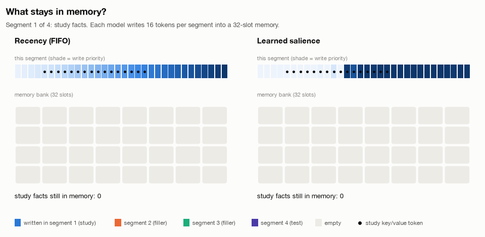
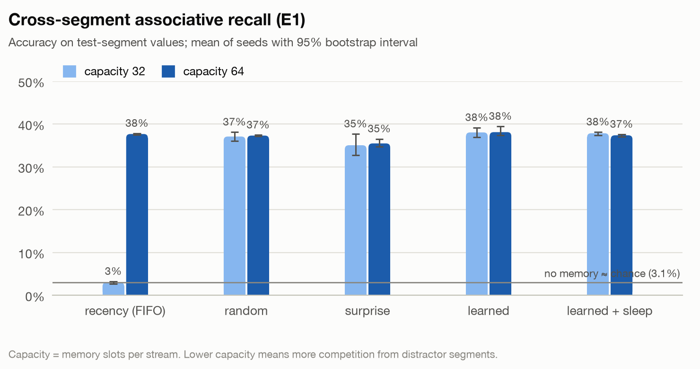
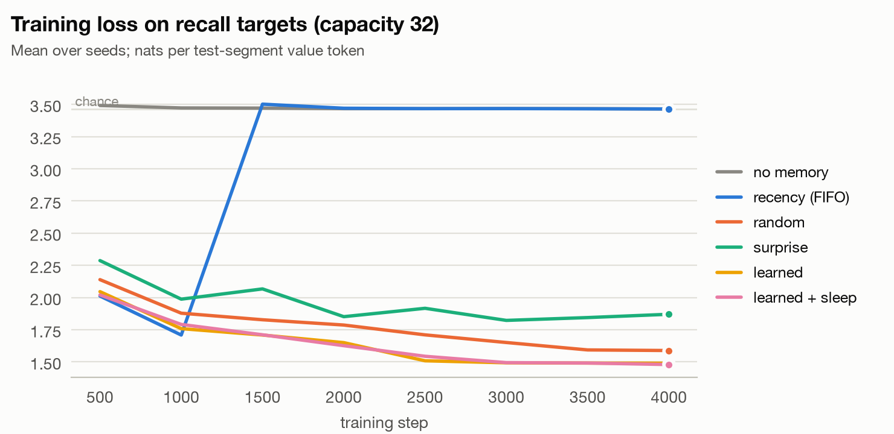
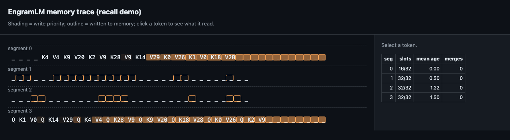
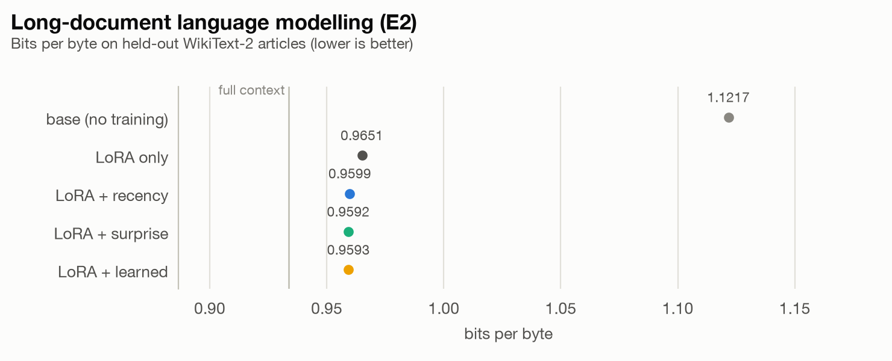
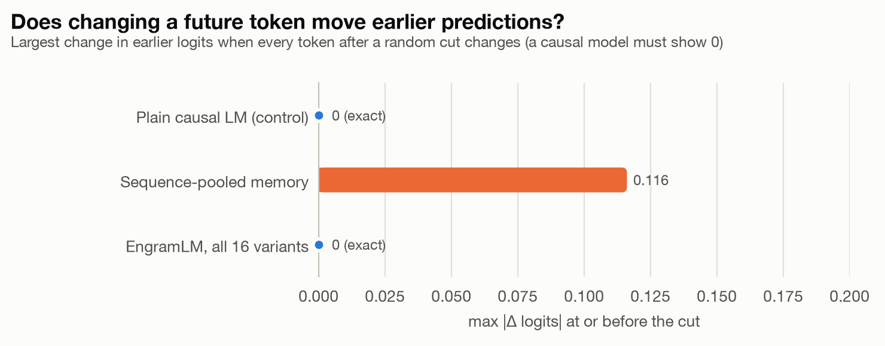
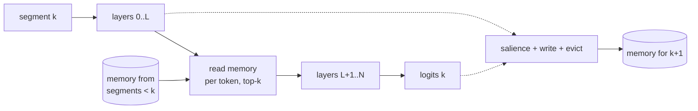

<picture>
  <source media="(prefers-color-scheme: dark)" srcset="docs/assets/banner-dark.svg">
  
</picture>

**Causal, salience-gated external memory for Hugging Face causal language models.**

[](https://github.com/Sanika0212/EngramLM/actions/workflows/ci.yml)


EngramLM wraps any causal LM (Llama, Qwen, Gemma, SmolLM, GPT-2, …) with a memory
that carries information across segments of a long document. After each segment
it decides which tokens matter (salience), writes them into a fixed-size bank,
evicts what has gone stale, and lets later segments read from it, one token at a
time. It is **causal by construction**, starts out **identical to the base model**,
and ships a **numerical audit** that proves both properties instead of assuming
them.

<picture>
  <source media="(prefers-color-scheme: dark)" srcset="docs/assets/memory-dark.gif">
  
</picture>

## Why

Memory modules for LMs are easy to get subtly wrong. If anything in the memory
path pools over the current sequence, predictions can see future tokens and
perplexity drops for the wrong reason. EngramLM is built so that this cannot
happen. Memory read in segment *k* only ever contains writes from segments
before *k*, and `engramlm audit` checks it numerically on any model.

## Features

1. **Per-token, past-only reads** at a configurable decoder layer, via a forward
   hook. Works with any Hugging Face causal LM, with no model surgery.
2. **Explicit `MemoryState`** per stream. Evaluation is deterministic and batches
   never share memory.
3. **Vectorized writes and eviction**: `priority` (decayed) or `fifo`, with no
   Python loops over tokens.
4. **Pluggable salience**:
   1. `surprise`: the model's own token NLL.
   2. `learned`: a small MLP trained through later reads, initialised to equal `surprise`.
   3. `random` and `recency` controls.
5. **Sleep-phase consolidation**: merges near-duplicate memories at a fixed budget
   and conserves total priority mass.
6. **Identity at initialisation**: an untrained wrapper reproduces the base model's
   logits bit-for-bit.
7. **Causality audit** (`engramlm audit`): perturbs future tokens and checks that
   earlier logits do not move.
8. **Memory inspector**: a self-contained HTML trace of salience, writes and the
   provenance of every read.
9. **Fair evaluation**:
   1. bits per byte;
   2. identical target sets across variants;
   3. a LoRA-only control;
   4. a full-context reference;
   5. bootstrap intervals.
10. **Training** with truncated backprop through memory, LoRA via PEFT, and
    adapter-only checkpoints.

## Install

```bash
git clone https://github.com/Sanika0212/EngramLM.git
cd EngramLM
uv sync --extra train        # or: pip install -e ".[train]"
```

Requires Python 3.11+. Core dependencies: PyTorch, Transformers, safetensors,
NumPy, PyYAML. The `train` extra adds PEFT and Datasets.

## Quickstart

```python
import torch
from transformers import AutoTokenizer

from engramlm.config import EngramConfig
from engramlm.generation import generate
from engramlm.model import EngramLM
from engramlm.segment import evaluate_document

name = "HuggingFaceTB/SmolLM2-135M"
tokenizer = AutoTokenizer.from_pretrained(name)
model = EngramLM(EngramConfig(base_model_name=name, capacity=256, writes_per_segment=32)).eval()

ids = tokenizer(open("long_document.txt").read(), return_tensors="pt").input_ids
result = evaluate_document(model, ids, segment_len=128)        # memory carried across segments
print(result.mean_nll, int(result.memory.num_valid()[0]))

prompt = ids[:, -32:]
out = generate(model, prompt, memory=result.memory, max_new_tokens=32)
print(tokenizer.decode(out[0, prompt.shape[1]:]))
```

A complete runnable version is in [`examples/quickstart.py`](examples/quickstart.py).

## Command line

```bash
engramlm audit --tiny                                    # offline causality smoke test
engramlm audit --model HuggingFaceTB/SmolLM2-135M        # audit a wrapped pretrained model
engramlm recall --config configs/recall.yaml --out runs/recall           # experiment E1
engramlm lm --config configs/lm-smollm2.yaml --out runs/lm --device mps  # experiment E2
engramlm inspect --checkpoint runs/ckpt --text doc.txt --out trace.html  # memory inspector
```

## Results

### E1: carrying facts across segments

Each document has four 32-token segments:

1. a study segment with 8 key/value pairs at a random offset among filler;
2. two filler segments;
3. a test segment that asks for the 8 values.

The model reads one segment at a time, so without memory it can only guess (3.1%).
The models are small 3-layer Llama-style networks trained from scratch for 4,000 steps,
3 seeds each, and evaluated on 512 documents. Every variant writes 16 of each
segment's 32 tokens.

<picture>
  <source media="(prefers-color-scheme: dark)" srcset="docs/assets/recall-accuracy-dark.png">
  
</picture>

| Variant | Capacity 32 | Capacity 64 |
|---|---|---|
| No memory | 2.9% [2.6, 3.3] | n/a |
| Recency (first in, first out) | 3.0% [2.7, 3.2] | 37.7% [37.5, 37.8] |
| Random eviction | 37.1% [36.1, 38.1] | 37.3% [37.2, 37.4] |
| Surprise salience | 35.0% [32.7, 37.7] | 35.5% [34.7, 36.5] |
| Learned salience | 38.0% [36.9, 39.2] | 38.1% [37.3, 39.5] |
| Learned salience + sleep consolidation | 37.8% [37.3, 38.1] | 37.4% [37.0, 37.6] |

The figures are mean accuracy over 3 seeds, with 95% bootstrap intervals.

What this shows:

1. **The memory works.** Every variant that keeps the study segment recalls about 12
   times more values than chance.
2. **Eviction matters when memory is small.** With 32 slots, the two filler segments
   push the whole study segment out of a first-in-first-out memory, and recall drops
   to chance. Any priority-based policy keeps enough of it.
3. **On this task, choosing which tokens to keep matters little.** Learned salience
   scores highest, but it is within the interval of random eviction. With 16 writes
   per segment, random choices already keep about a third of the study tokens. A
   value token's hidden state can also carry its key from the same segment, so one
   surviving token per pair may be enough. E1b, a version with a tight write budget,
   tests salience directly.

Two fixes were needed before every seed trained:

1. **Sleep consolidation cut the gradient.** It rebuilt memory from detached copies,
   so the scorer could never learn with consolidation on. Merges are now applied
   differentiably.
2. **A curriculum.** The study-to-test gap grows over the first 1,500 steps. Without it,
   many seeds never learned to read memory at all.

The training curves show the curriculum at work: first-in-first-out memory falls back
to chance exactly when the full gap appears.

<picture>
  <source media="(prefers-color-scheme: dark)" srcset="docs/assets/training-curves-cap32-dark.png">
  
</picture>

The [memory inspector](docs/assets/inspector-demo.html) shows what a trained model
wrote and read, token by token:



### E2: long-document language modelling

SmolLM2-135M reads WikiText-2 test articles of 512 tokens in 128-token segments, with
40 articles and one seed. Every memory variant is trained with LoRA, so the comparison
that matters is against LoRA alone. Full context (the whole article in one window) is
the upper bound.

<picture>
  <source media="(prefers-color-scheme: dark)" srcset="docs/assets/lm-results-dark.png">
  
</picture>

| Variant | Bits per byte | Perplexity |
|---|---|---|
| Base model, segment-local | 1.1217 | 29.16 |
| LoRA only | 0.9651 | 18.21 |
| LoRA + recency memory | 0.9599 | 17.93 |
| LoRA + surprise memory | 0.9592 | 17.89 |
| LoRA + learned memory | 0.9593 | 17.89 |
| Full context (upper bound) | 0.9336 | 16.56 |

Memory lowers bits per byte by about 0.6% over LoRA alone. That recovers roughly a
fifth of the gap to full context. It is a single seed on a small model, so treat it as
a direction, not a measured effect size.

### Causality

`engramlm audit` changes every token after a random cut and measures how far the
logits before the cut move. A causal model must show exactly zero. A memory that pools
over the current sequence leaks future information; EngramLM does not, in any of its
16 configurations.

<picture>
  <source media="(prefers-color-scheme: dark)" srcset="docs/assets/causality-dark.png">
  
</picture>

## How it works



1. Each token at `memory_layer` queries its stream's bank and reads its top-k
   slots. Retrieval is biased by each slot's stored priority.
2. The base model finishes the segment and produces logits.
3. A salience scorer ranks the segment's tokens, and the top `writes_per_segment`
   are written. Slots age, and the bank keeps the `capacity` best by retention
   score.
4. Optionally, every N segments, near-duplicate slots are merged.

Details: [`docs/architecture.md`](docs/architecture.md). Evaluation protocol:
[`docs/evaluation.md`](docs/evaluation.md).

## Development

```bash
uv run pytest --cov            # 120+ tests on tiny random models, no downloads
uv run ruff check src tests && uv run ruff format --check src tests
uv run mypy                    # strict
uv run engramlm audit --tiny
```

See [`CONTRIBUTING.md`](CONTRIBUTING.md).

## Limitations

1. Memory reads happen at one decoder layer; multi-layer reads are not implemented.
2. Consolidation is greedy and runs per stream on the host; it is meant to run
   every few segments, not every step.
3. The laptop-scale experiments use small models. GPU-scale configs are included
   but have not been run yet.
4. In E1, learned salience does not beat random eviction by more than seed noise.
   E1b tests whether choosing what to remember helps under a tight write budget.
5. E2 is a single seed. Its gain over LoRA alone (about 0.6% bits per byte) is small.

## Citation

See [`CITATION.cff`](CITATION.cff).

## References

1. Transformer-XL (Dai et al., 2019) and Memorizing Transformers (Wu et al., 2022)
   for past-only, retrieval-based memory over long documents.
2. LoRA (Hu et al., 2021) for low-rank adaptation and zero-initialised updates.

## License

Apache License 2.0. Copyright 2026 Sanika Najan. See [LICENSE](LICENSE) and
[NOTICE](NOTICE).

Model weights and datasets used by the experiments are downloaded at run time and
keep their own licenses.
