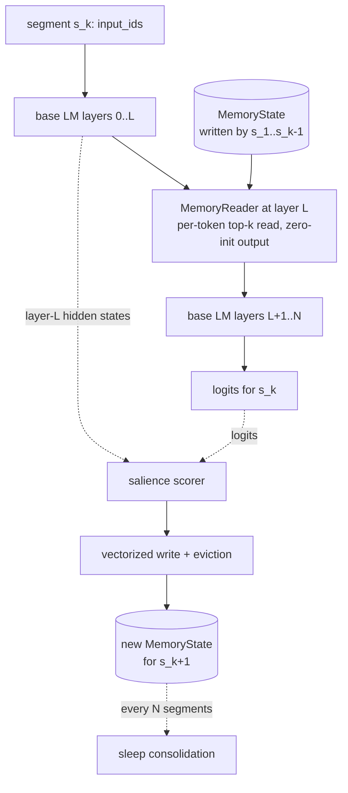

# Architecture

EngramLM adds an external, per-stream memory to any Hugging Face causal language
model. The base model keeps its own attention window; memory carries selected
information from earlier segments of a long document into later ones.

## One segment, step by step

1. **Read.** A forward hook on decoder layer `memory_layer` passes each token's
   hidden state to `MemoryReader`. Every token builds its own query, scores the
   valid slots of its stream's bank, attends to its `read_top_k` best matches,
   and adds `tanh(gate) * W_out(read)` to the residual stream.
2. **Predict.** The rest of the base model runs as usual and produces logits.
3. **Score.** A salience scorer assigns each token of the segment a priority in
   `(0, 1)`, using the layer-L hidden states and the segment's own logits.
4. **Write.** The `writes_per_segment` highest-priority tokens are appended to
   the bank. Existing slots age by one segment, and the bank keeps the `capacity`
   slots with the best retention score (`priority * decay ** age` or FIFO).
5. **Consolidate (optional).** Every `consolidate_every` segments, near-duplicate
   slots are merged.

## Why it is causal

Memory read during segment *k* contains only writes from segments *1..k-1*, and
writes from segment *k* happen after its logits are final. Within a segment, each
token's read depends only on its own hidden state, which the causal base model
computes from tokens at or before it. Nothing in the read path pools over the
sequence. The test suite checks this exactly: perturbing tokens after a cut
point leaves all earlier logits **bit-identical**, for every scorer, eviction
policy and consolidation setting. `engramlm audit` runs the same check on any
model.

## Identity at initialisation

`W_out` starts at zero, so an untrained wrapper returns exactly the base model's
logits. Fine-tuning therefore starts from the base model, and ablations compare
like with like. The output projection (not a gate) is what starts at zero: a
zero gate would also zero the gradient of every reader weight behind it, and the
reader would never learn. That failure was observed during development and is
covered by a regression test.

## Training the write policy

Retrieval scores include `priority_strength * log(priority)`. Because stored
priorities keep their autograd graph within a truncated-BPTT window
(`TrainConfig.bptt_segments`), the `learned` scorer receives gradient from the
loss of later segments. A write that helps later predictions raises its own
priority, and one that does not is pushed down and evicted sooner. The learned
scorer is initialised to reproduce the parameter-free `surprise` scorer, so
training refines a sensible prior.

## Components

| Module | Responsibility |
|---|---|
| `engramlm.memory.state` | `MemoryState`: explicit per-stream bank (vectors, priority, age, provenance) |
| `engramlm.memory.bank` | `write`: vectorized top-k selection and eviction, no Python loops over tokens |
| `engramlm.memory.policies` | retention scores: `priority` (decayed) and `fifo` |
| `engramlm.memory.consolidation` | sleep-phase merging that conserves total priority mass |
| `engramlm.salience` | `surprise`, `learned`, `random`, `recency` scorers |
| `engramlm.reader` | `MemoryReader`, optional low-rank stale-memory adapter, `probe_reads` |
| `engramlm.model` | `EngramLM` wrapper and forward hook |
| `engramlm.segment` / `generation` | document scoring and KV-cached generation |
| `engramlm.audit` | numerical causality audit |
| `engramlm.inspector` | HTML trace of writes and reads |
| `engramlm.eval`, `engramlm.experiments` | metrics, statistics, E1 and E2 |
